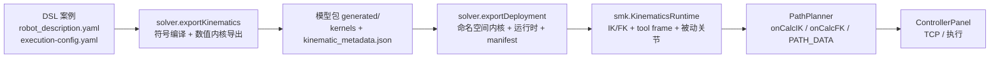
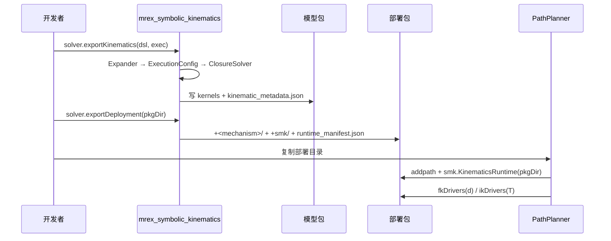

# 从 mrex_symbolic_kinematics 导出运动学模型到 PathPlanner

> 本文档描述 **DSL 案例 → 自包含模型包 → 部署包 → PathPlanner 运行时** 的完整链路，
> 包括调用的服务/组件、每一步发生什么、产物结构、运行时数学契约，以及 PathPlanner 侧
> 需要补充的适配代码。
>
> 当前状态（2026-10-20）：**本 repo 的 P0/P1 已实现**——模型包导出、单点 IK/FK、
> 运行时 tool frame、驱动-only FK、命名空间部署、`ikTrajectory`、硬限位/分支跳变
> 诊断、`IK_<name>.m` / `FK_<name>.m` 顶层包装。**PathPlanner 侧适配仍待开发**；
> 3T2R 显式流形投影和解析被动雅可比留待后续。

---

## 1. 总体架构





职责边界：

| 层 | 归属 | 职责 |
|---|---|---|
| 编译 | `mrex_symbolic_kinematics` | DSL → IR → 符号残差/位姿 → 数值内核 |
| 模型包 | `mrex_symbolic_kinematics` | 自包含 `.m` 内核 + 机器可读元数据 |
| 部署 | `mrex_symbolic_kinematics` | 命名空间化内核 + 运行时类 + 部署清单 |
| 运行 | `mrex_symbolic_kinematics` | target-aware IK、FK、tool frame、被动关节求解 |
| 业务 | PathPlanner | 目标路径生成、时序、`PATH_DATA`、TCP、执行 |
| 评估 | mrex_generative | 工作空间扫描、体积、绘图、批处理 |

---

## 2. 调用的服务与组件

### 2.1 导出阶段

| 组件 | 文件 | 作用 |
|---|---|---|
| `ir.Expander` | `scripts/matlab/+ir/Expander.m` | 加载 DSL + 模块库，展开实例、连接、FK 传播，生成符号位姿 |
| `ir.ExecutionConfig` | `scripts/matlab/+ir/ExecutionConfig.m` | 加载 L3 执行配置：known/unknown、closure cuts、world binding、tool frame |
| `solver.ClosureSolver` | `scripts/matlab/+solver/ClosureSolver.m` | 构造 world-anchored 闭环残差、零位标定 `T_bind`、解析 `U = T_root←tool` |
| `solver.TaskSpaceAnalyzer` | `scripts/matlab/+solver/TaskSpaceAnalyzer.m` | 零位探针分析 mobility / rotation / 输入类型与轴向标签 |
| `solver.exportKinematics` | `scripts/matlab/+solver/exportKinematics.m` | 把符号模型编译为自包含数值内核 + `kinematic_metadata.json` |

### 2.2 运行时阶段

| 组件 | 文件 | 作用 |
|---|---|---|
| `solver.KinematicsRuntime` | `scripts/matlab/+solver/KinematicsRuntime.m` | 单点 IK/FK、target 映射、LM + warm start、tool frame、驱动-only FK |
| `solver.exportDeployment` | `scripts/matlab/+solver/exportDeployment.m` | 生成 `+<mechanism>/` 命名空间内核、`+smk/KinematicsRuntime.m`、`runtime_manifest.json` |
| `smk.KinematicsRuntime` | 部署包内 | 与 `solver.KinematicsRuntime` 同源的自包含运行时类 |

### 2.3 PathPlanner 阶段

| 组件 | 作用 |
|---|---|
| `PathPlannerClient` | TCP 客户端、`GetStatus`、`PlanPath`、`ExecutePath` |
| `onCalcIK` | 目标位姿 → 驱动轨迹 `N×6` |
| `onCalcFK` | 6 个驱动位移 → 当前工具位姿 |
| `PATH_DATA` | 下发 ControllerPanel 的轨迹格式 |
| `robot_params.m` / `sim_params.m` | 关节限位、初始位姿、仿真参数 |

---

## 3. 产物结构

### 3.1 模型包（`exportKinematics`）

默认写入：

```text
specs/dsl/cases/<case>/generated/
├── README.md
├── kinematic_metadata.json
├── closure_residual.m              # closed_loop
├── closure_residual_jacobian.m     # closed_loop
├── fk_tool.m
├── fk_all.m
└── fk_all_matrix.m
```

`kinematic_metadata.json` 的运行时关键字段：

| 字段 | 含义 |
|---|---|
| `inputs.names` | `q` 的列顺序（v00：6 个驱动 + 4 个内部转动） |
| `inputs.types` | `prismatic` / `revolute` |
| `inputs.roles` | `actuated` / `passive` |
| `inputs.actuated_indices` / `passive_indices` | 驱动/被动关节索引 |
| `closure.cuts[].T_bind` | 每个 world cut 的零位标定 |
| `task_frame.U` | `U0 = T_root←tool`（零位） |
| `task_frame.C` | `C = T_root←endFrame`（v00 为 `I₄`） |
| `task_frame.U_rel` | 导出时声明的默认 `T_endFrame←tool` |
| `tolerances` | `translation_mm` / `rotation_rad` |
| `task_space` | mobility / rotation / dims / probe |
| `frames[]` | `fk_all_matrix` 行块 ↔ frame 名 |
| `runtime` | API、版本、单位、支持的运行时方法 |

### 3.2 部署包（`exportDeployment`）

```text
generated/
├── kinematic_metadata.json
├── runtime_manifest.json
├── IK_mrex_3t2r_v00.m          # IK 包装（仅支持 IK 的包）
├── FK_mrex_3t2r_v00.m          # FK 包装
├── +mrex_3t2r_v00/
│   ├── closure_residual.m
│   ├── closure_residual_jacobian.m
│   ├── fk_tool.m
│   ├── fk_all.m
│   └── fk_all_matrix.m
└── +smk/
    └── KinematicsRuntime.m
```

`runtime_manifest.json` 记录：

- `mechanism` / `source_package`
- `kernel_package`（如 `mrex_3t2r_v00`）
- `runtime_class`（`smk.KinematicsRuntime`）
- `api_version`
- `units`
- `actuated_indices` / `passive_indices`
- `lower` / `upper`（若模型包带硬限位）
- `wrapper_ik` / `wrapper_fk`
- 支持的运行时方法

> `IK_<mechanism>` / `FK_<mechanism>` 使用**运行时语义**：`T` 是固定世界系工具位姿
> （4×4，mm / rad），`q` 为 `metadata.inputs.names` 顺序（mm / rad）。
> 不要与 mrex_generative 旧版 `IK_/FK_` 的“package `fk_tool` 位姿 + mm/deg”契约混用；
> 消费端适配时需要显式转换。

---

## 4. 导出与部署流程

### 4.1 导出模型包

在 `mrex_symbolic_kinematics` 根目录：

```matlab
addpath(genpath('scripts/matlab'));

out = solver.exportKinematics( ...
    'specs/dsl/cases/mrex_3t2r_v00/robot_description.yaml', ...
    'specs/dsl/cases/mrex_3t2r_v00/execution-config.yaml');
```

内部发生：

1. `ir.Expander` 展开 DSL，生成所有 frame 的符号位姿；
2. `ir.ExecutionConfig` 解析 known/unknown、world binding、closure cuts、tool frame；
3. `solver.ClosureSolver` 在零位标定 `T_bind`，构造 12 分量 world-cut 残差；
4. `matlabFunction` 把残差、解析雅可比、`fk_tool`、`fk_all_matrix` 编译为独立 `.m`；
5. `solver.TaskSpaceAnalyzer` 生成 `inputs.types/axes`、`task_space`；
6. 写入 `kinematic_metadata.json`、README 和全部内核。

> 导出需要 **Symbolic Math Toolbox**；导出后的模型包只依赖 base MATLAB。

### 4.2 验证模型包

```matlab
q = zeros(10, 1);
norm(closure_residual(q)) < 1e-12       % 零位闭环
norm(fk_tool(q) - eye(4)) < 1e-12       % 工具系零位
size(closure_residual_jacobian(q))      % [12 10]，全部有限
```

v00 的预期：`U0 = Trans(0, 0, -1 mm)`（工具系姿态与 tip 零位重合）、`C = I₄`、`inputs.roles` 为 6 个 `actuated` + 4 个 `passive`。

### 4.3 生成部署包

```matlab
dep = solver.exportDeployment(out.OutputDir);
```

或输出到单独目录：

```matlab
dep = solver.exportDeployment(out.OutputDir, ...
    'OutputDir', '/path/to/pathplanner/kinematics/mrex_3t2r_v00');
```

内部发生：

- 复制/改写数值内核到 `+<mechanism>/`，避免通用函数名冲突；
- 复制 `KinematicsRuntime.m` 到 `+smk/`；
- 生成 `IK_<mechanism>.m`（仅支持 IK 的包）与 `FK_<mechanism>.m`；
- 写入 `runtime_manifest.json`；
- 如果 `OutputDir` 与模型包目录不同，同时复制 `kinematic_metadata.json`。

### 4.4 拷贝到 PathPlanner

把整个部署目录放到 PathPlanner 的 kinematics 目录，例如：

```text
PathPlanner/kinematics/mrex_3t2r_v00/
├── kinematic_metadata.json
├── runtime_manifest.json
├── +mrex_3t2r_v00/
└── +smk/
```

不要只拷贝 `.m` 文件；元数据和命名空间目录必须一起保留。

> `generated/` 在本仓库中通常被 `.gitignore` 忽略。正式交付时需归档或单独复制。

---

## 5. 运行时数学契约

### 5.1 输入向量与单位

- `q`：`nq×1 double`，顺序 = `metadata.inputs.names`；
- 长度单位 **mm**，角度单位 **rad**；
- v00：`q = [manipulator_1.dx/dy/dz, manipulator_2.dx/dy/dz, joint_1..4.q]`；
- 前 6 个为驱动，后 4 个为被动关节。

### 5.2 位姿与 tool frame

定义：

- \(D_0(q) = \texttt{fk\_tool}(q)\)：模型包任务位姿，零位 \(D_0(0)=I_4\)；
- \(U_0 = T_{\text{root}\leftarrow\text{tool}}\)：`task_frame.U`；
- \(C = T_{\text{root}\leftarrow\text{endFrame}}\)：`task_frame.C`；
- \(U_{\text{rel}} = T_{\text{endFrame}\leftarrow\text{tool}}\)：运行时输入。

则：

\[
W(q) = U_0 D_0(q) U_0^{-1}
\]

\[
T_{\text{tool}}(q) = W(q)\,C\,U_{\text{rel}}
\]

`KinematicsRuntime` 的接口：

```matlab
D  = rt.fkPackage(q);                  % D0
T  = rt.fk(q, Urel);                   % 固定世界系工具位姿
```

### 5.3 目标位姿 IK

给定固定世界系目标 `T_target_tool`：

\[
W_{\text{target}} = T_{\text{target,tool}} U_{\text{rel}}^{-1} C^{-1}
\]

\[
D_{\text{target}} = U_0^{-1} W_{\text{target}} U_0
\]

然后调用 target-aware IK。内部对每个 world cut：

\[
K_c = T_{\text{bind},c}^{-1} W^{-1} T_{\text{bind},c}
\]

\[
r_c(q;D) = \mathrm{vec}\left(\mathrm{vec}^{-1}(r_{0,c}(q))\,K_c\right)
\]

`r_{0,c}` 是导出的零位残差；`K_c` 把目标注入到常量侧。求解器使用导出解析雅可比 + Levenberg-Marquardt，并用上一帧 `q` 做 warm start。

> **不要**直接拿 `closure_residual(q)` 当任意目标位姿的 IK 残差：它在导出时编译在
> `TipTarget = I₄`。`KinematicsRuntime` 内部已经通过 `K_c` 完成目标注入；如果消费端
> 自己实现 IK，必须复现这一步。

### 5.4 驱动-only FK

`fk_tool(q)` 需要完整 `nq` 个关节量。PathPlanner 的 `GetStatus` 只有 6 个驱动位移，因此 `fkDrivers` 会：

1. 固定 6 个驱动值；
2. 用两个 world cut 的 ground-ground 相对约束解 4 个被动关节：

\[
G_1(q)^{-1}G_c(q)\left(T_{\text{bind},1}^{-1}T_{\text{bind},c}\right)^{-1}=I
\]

3. 再调用 `fk_tool(q)` 得到位姿。

如果 PathPlanner 能读到被动关节编码器，也可以直接传入 `qint`，跳过求解。

---

## 6. PathPlanner 侧需要添加的支持

### 6.1 一个薄适配层

建议新增一个类或函数集合，例如：

```text
PathPlanner/
└── kinematics/
    ├── mrex_3t2r_v00/          % 部署包
    └── PathPlannerKinematics.m % 适配层
```

适配层职责：

- `addpath` 部署目录；
- 创建 `smk.KinematicsRuntime`；
- 位姿约定转换；
- 驱动/被动关节映射；
- 限位、失败处理、warm start；
- 生成 `PATH_DATA`。

### 6.2 初始化

```matlab
classdef PathPlannerKinematics < handle
    properties
        rt
        Urel                % 默认使用包内声明的 tool frame
    end
    methods
        function obj = PathPlannerKinematics(pkgDir)
            addpath(pkgDir);
            obj.rt = smk.KinematicsRuntime(pkgDir);
            obj.Urel = obj.rt.Urel0;
        end
    end
end
```

### 6.3 `onCalcFK`

输入：`GetStatus` 返回的 MC1/MC2 六个位移。

```matlab
function T = onCalcFK(obj, d)
    % d = [MC1.x MC1.y MC1.z MC2.x MC2.y MC2.z]
    [T, q, ok, info] = obj.rt.fkDrivers(d, obj.Urel);
    if ~ok
        warning('PathPlanner:FK:notConverged', ...
            'passive solve residual = %.3e', info.passive_norm);
    end
end
```

驱动顺序映射（v00）：

```text
d(1:3) -> manipulator_1.dx/dy/dz -> MC1 X/Y/Z
d(4:6) -> manipulator_2.dx/dy/dz -> MC2 X/Y/Z
q(7:10) -> joint_1..4.q（被动，不下发）
```

### 6.4 `onCalcIK`

输入：目标工具位姿 `(Xt, Yt, Zt, Phit, Thetat, Psit)`。  
`targets` 可以是 `N×6` 的 `[x y z phi theta psi]` 数组，也可以先由 PathPlanner
转成 `4×4×N` / cell；运行时层只接受 4×4 齐次变换，避免把 Euler 约定耦合进模型包。

```matlab
function dTraj = onCalcIK(obj, targets)
    N = numel(targets);
    dTraj = zeros(N, 6);
    q = [];                         % 首帧用零位或当前状态
    for k = 1:N
        T = obj.poseToT(targets(k)); % 4×4
        [d, qint, ok, info] = obj.rt.ikDrivers(T, obj.Urel, q);
        if ~ok
            error('PathPlanner:IK:notConverged', ...
                'frame %d residual %.3e', k, info.maxAbs);
        end
        dTraj(k, :) = d(:).';
        % 按 metadata 索引组装完整 q（不要假设驱动/被动一定前后连续）
        q = zeros(obj.rt.NQ, 1);
        q(obj.rt.ActuatedIndices) = d;
        q(obj.rt.PassiveIndices) = qint;
    end
end
```

P1 之后可以直接换成批量接口：

```matlab
[qTraj, dTraj, ok, info] = obj.rt.ikTrajectory(Ttargets, obj.Urel, q0, ...
    struct('StopOnFailure', false));
```

位姿转换：

\[
R = R_z(\psi) R_y(\theta) R_x(\phi)
\]

与仓库的 Z-Y-X 约定一致。`smk.KinematicsRuntime` 内部统一使用 **mm / rad**；
如果 PathPlanner 的 GUI 或配置使用 deg，在适配层完成转换，不要改动模型包内核。

### 6.5 轨迹层

本 repo 已提供批量轨迹 IK：

```matlab
[qTraj, dTraj, ok, info] = rt.ikTrajectory(Ttargets, Urel, q0, opts);
```

- `Ttargets`：`4×4×N`、cell 或 `N×6 [x y z rx ry rz]`；
- `Urel`：常量、逐帧 cell / `4×4×N` / `N×6`；
- 逐帧 warm start；
- `info` 包含 `maxAbs`、`iterations`、`utilization`、`limitActive`、
  `branchJump`、`feasible`；
- `opts.StopOnFailure` / `opts.MaxIter` 可配置。

PathPlanner 仍负责目标路径的生成、插值、时间参数化和 `PATH_DATA`；`ikTrajectory`
只把已经离散好的目标位姿批量转成 `N×nq` / `N×6`。显式 3T2R 流形投影、全局
分支选择策略仍可作为后续增强。

### 6.6 Tool frame

每次任务可以传不同的 `Urel`：

```matlab
Urel = eye(4);                     % 显式覆盖包默认 tool frame
Urel(1:3, 1:3) = Rz(rz) * Ry(ry) * Rx(rx);
Urel(1:3, 4) = [tx; ty; tz];       % mm
obj.Urel = Urel;
```

`Urel = T_tip←tool`，不是 `T_tool←tip`。换 `Urel` 不需要重新导出模型。

### 6.7 限位与安全

硬限位可以来自两处：

1. 导出时写入模型包：
   ```matlab
   out = solver.exportKinematics(dsl, exec, ...
       'Limits', struct('lower', lower, 'upper', upper));
   ```
   `lower/upper` 按 `metadata.inputs.names` 顺序，v00 为 `q` 的 10 个分量。
2. 运行时覆盖：
   ```matlab
   rt.setLimits(lower, upper);
   rt.clearLimits();
   ```

PathPlanner 侧仍需：

1. 从 `robot_params.m` 读取 MC1/MC2 的 X/Y/Z 行程；
2. 映射到 `inputs.actuated_indices` 对应的 6 个分量；
3. 对内部关节配置合理范围；
4. 在下发前检查 `dTraj` 和 `qint`；`ikTrajectory` 的
   `info.utilization` / `info.limitActive` / `info.feasible` 可直接用于过滤；
5. 对越界或不可达点拒绝、重规划或标记无效。

### 6.8 3T2R 目标可行性

v00 的任务空间是 **3T2R（5 维）**，不是任意 6-DOF。PathPlanner 生成目标位姿时必须：

- 限制在 3 平移 + 2 转动的流形上；
- 或用 `metadata.task_space` 检查目标是否可达；
- 对不可达目标，`ik` 会返回 `ok=false` 和较大残差，不能静默下发。

### 6.9 与现有 TCP / PATH_DATA 的关系

- `onCalcIK` 的输出仍是 `N×6` 驱动位移；
- `PATH_DATA` 打包、`PlanPath`、`ExecutePath`、TCP 协议不变；
- 变化只在 `onCalcIK` / `onCalcFK` 内部：Simulink 求解器 → `smk.KinematicsRuntime`；
- `ControllerPanel` 不需要知道模型是从 DSL 导出的。

### 6.10 回归验证

建议至少比较：

- 相同目标位姿序列下，新旧求解器的 MC1/MC2 位移差异；
- `FK(IK(T))` 回代误差；
- 单次 IK 耗时、warm start 迭代次数；
- 收敛率、限位拒绝率；
- 完整流程 `connect → GetStatus → onCalcIK → PlanPath → ExecutePath`。

---

## 7. 当前实现状态

| 能力 | 状态 |
|---|---|
| `solver.exportKinematics` 模型包 | ✅ P0 |
| `inputs.roles` / actuated/passive 索引 | ✅ P0 |
| `task_frame.C` / `U_rel` / runtime 元数据 | ✅ P0 |
| `solver.KinematicsRuntime` 单点 IK/FK | ✅ P0 |
| 运行时 tool frame | ✅ P0 |
| `fkDrivers` 驱动-only FK | ✅ P0 |
| `solver.exportDeployment` 命名空间部署 | ✅ P0 |
| `ikTrajectory` 批量轨迹 IK | ✅ P1 |
| 硬限位 / 分支跳变与逐帧诊断 | ✅ P1（显式流形投影待补） |
| `IK_<name>.m` / `FK_<name>.m` 顶层包装 | ✅ P1 |
| 3T2R 显式流形投影 | ⬜ 后续 |
| PathPlanner `onCalcIK` / `onCalcFK` 正式适配 | ⬜ PathPlanner 侧 |
| C-MEX / MATLAB Coder | ⬜ P2/E4 |

当前限制：

- 驱动/被动分区对 `closed_loop` 使用 `Manipulator` 模块启发式；非 `Manipulator` 驱动器需要显式元数据。
- `ik` 只支持 world-anchored cuts；L2 内部闭环包目前是 FK-only。
- `fkDrivers` 的被动关节雅可比是数值差分；P1 可导出解析 `loop_residual` / Jacobian。
- 一个 MATLAB 进程加载多个模型时，优先使用 `exportDeployment` 的命名空间包；否则通用函数名会冲突。

---

## 8. 验收清单

- [ ] `exportKinematics` 生成 7 个文件，`closure_residual(0) ≈ 0`。
- [ ] `fk_tool(0) ≈ I₄`，`U0` 与 execution-config 的 tool frame 一致。
- [ ] `metadata.inputs.actuated_indices` / `passive_indices` 正确。
- [ ] `exportDeployment` 生成 `+<mechanism>/`、`+smk/`、`runtime_manifest.json`。
- [ ] PathPlanner `addpath` 后能创建 `smk.KinematicsRuntime`。
- [ ] `fkDrivers(GetStatus())` 收敛，`ok=true`。
- [ ] `ikDrivers(T)` 后 `fkDrivers(d) ≈ T`。
- [ ] 换 `Urel` 后无需重新导出，FK/IK 往返一致。
- [ ] 目标序列逐点 IK 收敛，`N×6` 轨迹可直接进 `PATH_DATA`。
- [ ] `ikTrajectory` 的 `ok` 全 true，`info.branchJump` 无异常跳变。
- [ ] 有硬限位时 `info.utilization <= 1`。
- [ ] `IK_<name>` / `FK_<name>` 包装可独立调用。
- [ ] 与旧 Simulink 求解器对比，位移/位姿/耗时在验收范围内。

---

## 9. 常见问题

| 现象 | 可能原因 | 处理 |
|---|---|---|
| `KinematicsRuntime:kernelNotFound` | 部署目录未加入 path，或只复制了 `.m` 文件 | `addpath(pkgDir)`，保留 `+<mechanism>/` 结构 |
| `fk_tool(0) != I4` | 模型包与 DSL/execution-config 不一致 | 重新运行 `exportKinematics`，不要复用其他 case 的包 |
| `ik` 返回 `ok=false`、残差很大 | 目标不在 3T2R 流形上，或超出工作空间 | 检查 `task_space`，投影/拒绝不可达目标 |
| 换 tool frame 后位姿不对 | `Urel` 方向写反或单位错 | 用 `Urel = T_tip←tool`，平移 mm、旋转 rad |
| 多模型函数名冲突 | 多个通用内核同时在 path 上 | 使用 `exportDeployment` 的 `+<mechanism>` 命名空间包 |
| `fkDrivers` 不收敛 | 驱动位移超出闭环可达范围，或模型包非 world-anchored | 检查驱动限位；L2 包目前只支持 FK，不支持 driver-only solve |

---

## 10. 相关文档

| 文档 | 内容 |
|---|---|
| [`scripts/matlab/MODEL_EXPORT.md`](../../scripts/matlab/MODEL_EXPORT.md) | 模型导出三段式规划、E1–E4 |
| [`scripts/matlab/API_REFERENCE.md`](../../scripts/matlab/API_REFERENCE.md) | `exportKinematics` / `KinematicsRuntime` / `exportDeployment` API |
| [`docs/reference/pathplanner-architecture.md`](./pathplanner-architecture.md) | PathPlanner 现有架构、TCP、配置 |
| [`docs/reference/inverse-kinematics-solver-design.md`](./inverse-kinematics-solver-design.md) | 闭环机构 IK 的符号约束方法 |
