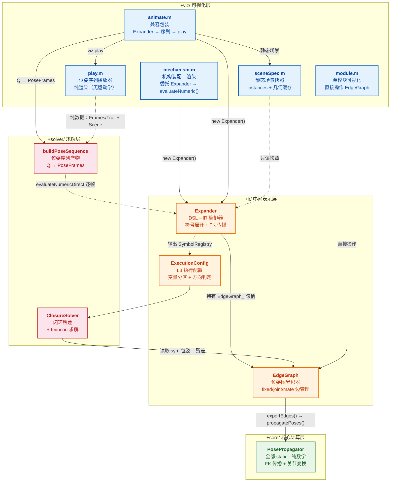
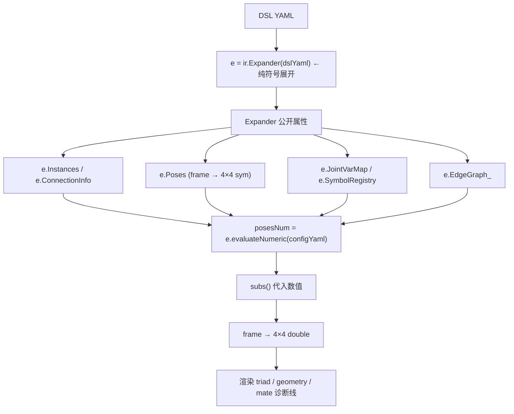
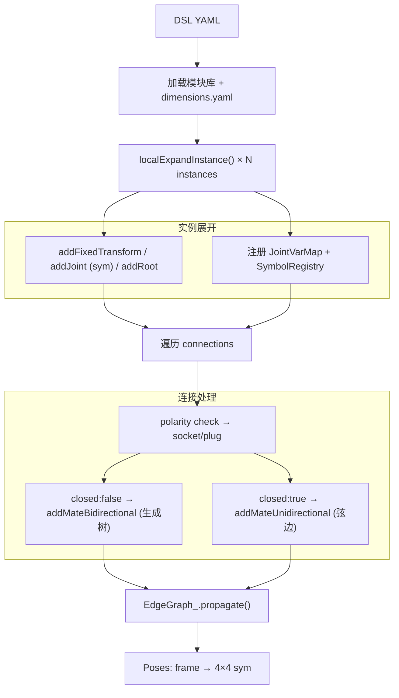
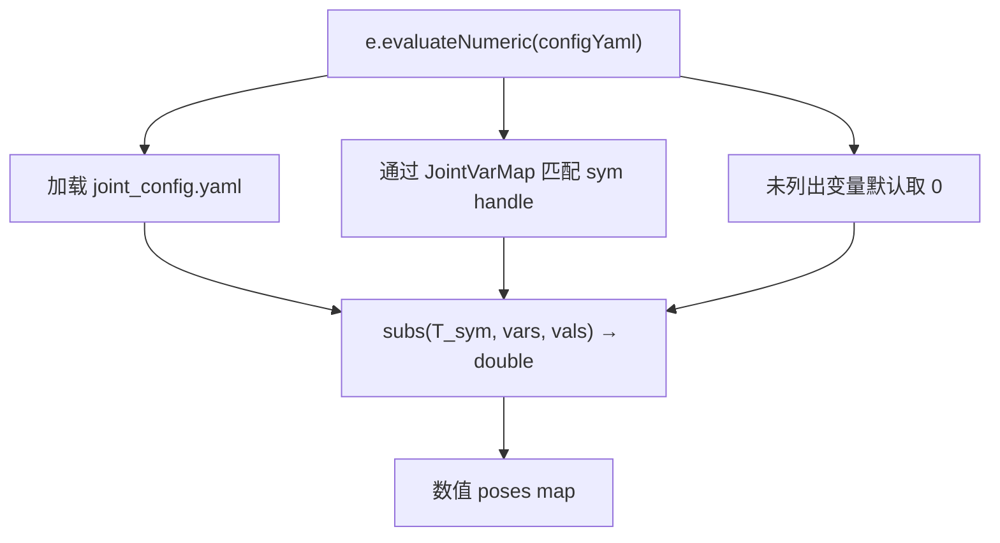
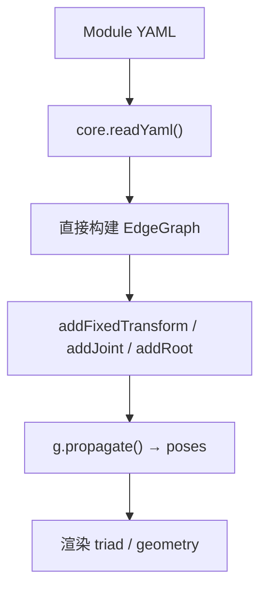
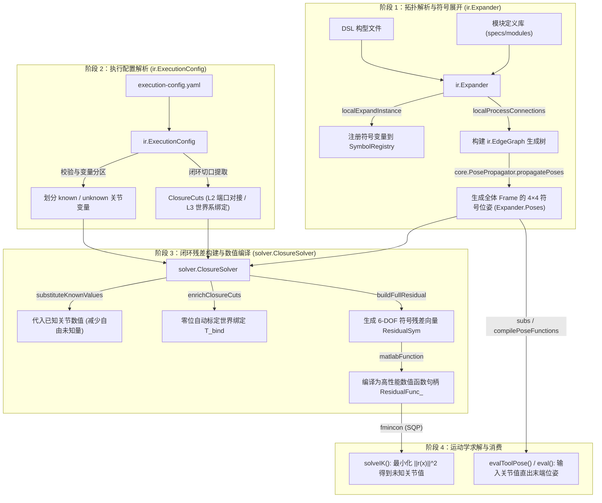

# scripts/matlab — 四层架构设计

> 本文档解释 `+core` / `+ir` / `+viz` / `+solver` 四层之间的职责划分与数据流。
> 各类的详细属性、方法签名、使用示例请参见 **[API_REFERENCE.md](./API_REFERENCE.md)**。

## 架构总览



> **层间调用链**：
> 1. `mechanism.m` / `animate.m` 构造 `Expander(dslYaml)` → 构造函数自动完成 DSL→IR 符号展开和 FK 传播
> 2. 渲染前调用 `e.evaluateNumeric()` → `sym` 位姿 → `double` 位姿；`animate.m` 自 A.5.2.0 起为分层包装（`buildPoseSequence` 产位姿序列 → `play` 消费渲染）
> 3. `Expander` 内部持有 `EdgeGraph_` 句柄，所有实例展开/连接处理均写入该图
> 4. `EdgeGraph.propagate()` 委托 `PosePropagator.propagatePoses()` 执行纯数学 FK
> 5. `module.m` 跳过 Expander，直接调用 `EdgeGraph` 方法构建单模块内部图
> 6. `Expander` 输出 `SymbolRegistry` → `ExecutionConfig` 交叉校验
> 7. `ClosureSolver` 从 `EdgeGraph` 取符号位姿构建闭环残差，通过 `fmincon` 求解

## 各层职责

### 可视化层 (`+viz/`)

- **`mechanism.m`**: 委托 `ir.Expander` 完成符号展开，调用 `evaluateNumeric()` 代入数值后渲染 triad / geometry / mate 诊断线。自身只读 Expander 的公开属性。
- **`module.m`**: 单模块可视化，直接调用 `ir.EdgeGraph` 方法（不经过 Expander），使用数值管线。
- **`animate.m`**: 轨迹动画兼容包装（A.5.2.0）＝ `ir.Expander` → `solver.buildPoseSequence` → `viz.sceneSpec` → `viz.play`；外部签名不变。
- **`play.m`**: 位姿序列纯播放器。只消费 `(PoseSequence, SceneSpec)` 纯数据，逐帧渲染循环 / 播放控件 / 轨迹叠加；**不做运动学计算**。
- **`sceneSpec.m`**: 从 `Expander` 提取静态场景快照（instances / 连接 / 几何缓存 / 特征尺度）。
- **`allModules.m`**: 批量校验所有模块 YAML。

> 详见 [API_REFERENCE.md § +viz/](./API_REFERENCE.md#viz-可视化层)

### 中间表示层 (`+ir/`)

- **`Expander`** (handle class): DSL→IR 编排器。构造函数即完整管线：加载 DSL + 模块库 → 实例展开 → 连接处理 → FK 传播 → 输出 `Poses`（符号）和 `SymbolRegistry`。A.4.0 起关节变量始终为 `sym`，数值代入推迟到 `evaluateNumeric()`。
- **`EdgeGraph`** (handle class): 位姿图累积器。管理 `fixed` / `joint` / `mate` / `closed_mate` 四种边，支撑混合 `double`/`sym` T 矩阵，桥接 `PosePropagator`。
- **`ExecutionConfig`** (value class): L3 执行配置，加载 YAML → Schema 校验 → 交叉验证 `SymbolRegistry` → 变量分区（known/unknown）→ 求解方向判定（FK/IK）。

> 详见 [API_REFERENCE.md § +ir/](./API_REFERENCE.md#ir-中间表示层)

### 求解层 (`+solver/`)

- **`ClosureSolver`** (handle class): 闭环约束构造器。支持两类 closure cut——L2 双 frame 切口与 L3 world 锚定切口（`anchor: world`，`world_binding` 零位自动标定）——构建 6-DOF 符号残差 → `matlabFunction` 编译 → `fmincon` SQP 求解 IK；`setTipTarget(ΔT)` 注入 tip 任务目标，known 关节值经构造参数代换。
- **`buildPoseSequence`** (函数): FK 位姿序列构建器（A.5.2.0）。`Q` → 逐帧全体 frame 位姿（`PoseSequence`，可选世界锚定共轭）——「求解器 → 位姿数据 → 渲染」数据流中的计算层产物。

> 详见 [API_REFERENCE.md § +solver/](./API_REFERENCE.md#solver-求解层)

### 核心计算层 (`+core/`)

- **`PosePropagator`** (全部 static): 无状态纯数学引擎。`propagatePoses(edges, seed)` 迭代 FK 传播（支持多根、混合 `double`/`sym`）；`jointTransform(kind, axis, value)` 构造关节变换矩阵。
- **`RigidBodyMath`** (全部 static): 3D 刚体变换原语（T 矩阵合成、轴角、RPY、对齐旋转）。
- **`CommonUtils`** (全部 static): 参数表达式求值、YAML 列表展开、struct 字段安全读取。
- **`PathUtils`** / **`VizHelpers`** / **`readYaml`**: 路径解析、渲染辅助、极简 YAML 解析。

## 数据流

### mechanism.m 路径（A.4.0 纯符号）



### Expander 内部管线（构造函数内完成）



### 数值化（延迟到渲染/求解时）



### module.m 路径（单模块）



## 运动学生成核心管线：从 DSL 到 IK/FK 算子

本节详细阐述一份机构描述 DSL 是如何被编译为中间表示（IR），并最终由 `ClosureSolver` 编译为可计算的闭环 FK/IK 函数的全过程。

### 1. 核心流程演进（四阶段生命周期）



### 2. 核心函数与方法详解

#### 阶段 1：拓扑解析与符号展开 (`ir.Expander` + `core.PosePropagator`)
- **入口**：`e = ir.Expander(dslYaml)`，位于 [scripts/matlab/+ir/Expander.m](scripts/matlab/+ir/Expander.m)。
- **方法 `localExpandInstance`**：加载各模块原型（如 `Joint.yaml`、`Manipulator.yaml`），为每个活动关节实例化独立的符号变量（如 `sym('manipulator_L_dx', 'real')`），并写入 `SymbolRegistry` 与 `JointVarMap`。
- **方法 `localProcessConnections`**：解析模块端口对接。对于闭环机构，生成树算法将主干保留为双向连通边（`addMateBidirectional`），而将闭合回路处标记为单向弦边（`addMateUnidirectional`，类型为 `closed_mate`）。
- **方法 `core.PosePropagator.propagatePoses`**：无状态纯数学 FK 引擎。从基座根坐标系（$I_4$）出发，沿生成树递归累乘局部刚体变换与符号关节变换：
  $$T_{child} = T_{parent} \cdot T_{offset} \cdot T_{joint}(q)$$
  输出所有 Frame 相对世界原点的 $4 \times 4$ 符号齐次变换矩阵字典 `Expander.Poses`。

#### 阶段 2：执行配置与变量分区 (`ir.ExecutionConfig`)
- **入口**：`cfg = ir.ExecutionConfig(execYaml, e.SymbolRegistry, e.EdgeGraph_)`，位于 [scripts/matlab/+ir/ExecutionConfig.m](scripts/matlab/+ir/ExecutionConfig.m)。
- **变量分区**：将机构中所有关节变量划分为 `known`（已知输入量，如主动驱动器的指定行程）和 `unknown`（未知待求量，如被动铰链角度或待反解的驱动轴）。
- **切口规范**：指定闭环缝合位置。支持两种切口：
  - **L2 机构**：双 Frame 对接切口（`near` 端口与 `far` 端口通过配合变换 $M$ 吻合）。
  - **L3 机构**（如 M-REx 3T1R）：世界系闭环切口（`anchor: world`，末端各支链与地面基座绑定）。
- **求解方向切换**：同一套机构仅通过更换 `execution-config.yaml` 即可在正运动学（`open_loop`，全部为 known）和逆运动学（`closed_loop`）之间切换。

#### 阶段 3：闭环残差构建与编译 (`solver.ClosureSolver`)
- **入口**：`cs = solver.ClosureSolver(e.EdgeGraph_, cfg, e.JointVarMap, knownValues)`，位于 [scripts/matlab/+solver/ClosureSolver.m](scripts/matlab/+solver/ClosureSolver.m)。
- **已知量代换 (`substituteKnownValues`)**：把已知关节数值代入所有符号位姿，消除已知变量，降低残差公式的求解维度。
- **零位标定 (`enrichClosureCuts`)**：在零位状态下求值，自动标定并固化世界系支链锚定矩阵 $T_{bind}$。
- **符号残差构造 (`buildFullResidual` / `buildResidualForCut`)**：
  - 切口两端在闭合时应满足重合关系。对于世界系切口，要求 $T_{near} = \Delta T^{-1} \cdot T_{bind}$，其相对误差矩阵为：
    $$T_{err} = T_{near}^{-1} \cdot (\Delta T^{-1} \cdot T_{bind})$$
  - 调用 `localSymbolicPoseErrorFromRelative` 将 $4 \times 4$ 矩阵 $T_{err}$ 解构为 6-DOF 误差分量：
    $$r(q) = \begin{bmatrix} t_x & t_y & t_z & r_x & r_y & r_z \end{bmatrix}^T$$
    其中平移取误差位置向量，旋转取 Z-Y-X 欧拉角（采用数值极其稳定的 $\arcsin(-R_{31})$ 计算）。
- **数值编译 (`toNumericFunction`)**：
  - 调用 MATLAB 符号编译器核心指令：
    ```matlab
    fh = matlabFunction(obj.ResidualSym, 'Vars', {obj.UnknownSyms.'});
    ```
  - **关键质变**：将沉重的符号代数树编译为轻量高效的纯数值函数句柄 `@(x)`，接收纯 `double` 向量，在微秒内算出残差数值。

#### 阶段 4：求解与求值
- **逆运动学求解 (`solveIK` / `solveIKWithTarget`)**：
  - 设定任务目标（支持 `setTipTarget` 或经过工具系共轭变换的 `setToolTarget`）。
  - 将残差平方和构造成最小二乘目标函数 $\min_x \|r(x)\|^2$。
  - 交由 `fmincon`（SQP 算法，配合中心差分 `central` 步长），从初始猜想值在毫秒级内收敛至机器精度（$\|r\| < 10^{-12}$）。
- **正运动学评估 (`evalToolPose` / `compilePoseFunctions`)**：
  - 已知关节数值 $q$ 时，直接由闭环切口位姿共轭推导工具系位姿 $D(q) = U^{-1} \cdot T_{rootWorld}(q) \cdot U$；
  - 或者调用 `Expander.compilePoseFunctions()` 预编译所有构件的独立位姿函数，实现毫秒级批量正运动学渲染或工作空间采样。

---

## 运算结果与产物的存放层级

系统在运行各阶段生成的数学与计算结果均组织在明确的内存对象中，层级划分如下：

| 层级 | 产物名称 | 存储位置与宿主 | 数据形态 | 典型用途与生命周期 |
| :--- | :--- | :--- | :--- | :--- |
| **拓扑与符号层** | 全局 Frame 符号位姿 | `Expander.Poses` (`containers.Map`) | $4 \times 4$ `sym` 矩阵 | 保留完整解析关系；用于解析求导、雅可比推导与结构分析。 |
| | 闭环符号残差 | `ClosureSolver.ResidualSym` | $N \times 1$ `sym` 向量 | 闭环几何约束的代数形式，严格定义了构型的运动约束流形。 |
| **数值算子层** | 残差/IK 数值函数句柄 | `ClosureSolver.ResidualFunc_` | `function_handle`<br/>`@(x) -> double` | 优化器高速调用，极速计算残差，脱离符号计算开销。 |
| | 全体构件 FK 函数库 | `Expander.PoseFuncs_`<br/>(由 `compilePoseFunctions` 生成) | `containers.Map`<br/>(`frame` $\to$ `@(q)`) | 快速求得各刚体位姿，支撑超低延迟机构动画渲染与碰撞检测。 |
| **纯数据产物层** | 轨迹位姿序列 | `buildPoseSequence` 产物 | `struct PoseSequence`<br/>(包含 Frames, Trail 等) | 无运动学依赖的纯数据切片，供 [scripts/matlab/+viz/play.m](scripts/matlab/+viz/play.m) 播放或落盘。 |
| **落盘产物层** | 自包含模型包 | `specs/dsl/cases/<case>/generated/`<br/>(由 `solver.exportKinematics` 生成) | 独立数值 `.m` 内核 + `kinematic_metadata.json` | 跨仓库消费（PathPlanner / M-REx Generative）；契约与文件清单见 [MODEL_EXPORT.md](./MODEL_EXPORT.md)。 |

---

## 模型导出与外部系统集成（摘要）

系统的对外交付形态是「符号工厂（编译器） → 自包含模型包 → 运行引擎（消费端）」三段式流水线：
`+solver/exportKinematics` 把 DSL 案例编译为**就地模型包**（`specs/dsl/cases/<case>/generated/`，
纯数值 `.m` 内核，仅依赖 base MATLAB），供 PathPlanner / M-REx Generative 等消费端直接调用。

> 完整规划已分离为独立文档 **[MODEL_EXPORT.md](./MODEL_EXPORT.md)**：三段式职责与接口契约、
> 阶段一（编译器）现状与两个符号展开根因修复、阶段二模型包产物规范、阶段三运行引擎消费场景、
> E1–E4 实施路线、导出介质对比。
>
> 当前状态：**E1 导出器 v0 已落地**（2026-10-14）；E2–E4 规划中。

---

## 关键设计决策

### 为什么 EdgeGraph 和 Expander 是 handle class

MATLAB 值语义会在多函数调用中强制传入传出累加器。handle class 支持原地修改，调用点干净。
`EdgeGraph` 在 `Expander.localExpandInstance` 中被反复追加边；`Expander` 自身持有 `EdgeGraph_` 和 `DefCache_` 两个可变状态。

### 为什么 ExecutionConfig 是 value class

配置是不可变数据——构造后即冻结，value 语义更安全，避免意外共享修改。

### 为什么 PosePropagator 全部 static

FK 传播是无状态的纯数学运算——输入边 + 种子位姿 → 输出全局位姿 map。static 方法消除不必要的对象开销。

### 符号/数值分离 (A.4.0)

Expander 构造函数**始终**产生符号位姿（`Poses` 为 `frame → 4×4 sym`）。数值代入延迟到 `evaluateNumeric()` 时。这使同一份符号展开结果可被多次数值化（不同配置、动画逐帧），且 `ClosureSolver` 等下游求解器可直接消费符号表达式。

### closed_mate 与闭环处理

- `addMateBidirectional`（双向）: 生成树边，参与 FK 传播
- `addMateUnidirectional`（单向）: 闭环弦边，`exportEdges()` 排除，不参与 FK 传播，仅用于诊断残差
- `ClosureSolver` 读取 `ExecutionConfig.ClosureCuts`（可来自 YAML 显式声明或从 `closed_mate` 自动推导），重新传播符号位姿后构建闭环残差
- `anchor: world` 切口（L3 世界系闭环）：far 侧取 `world_binding` 标定常量（`T` 省略时零位自动标定），`setTipTarget(ΔT)` 将任务目标注入 far 常量侧
