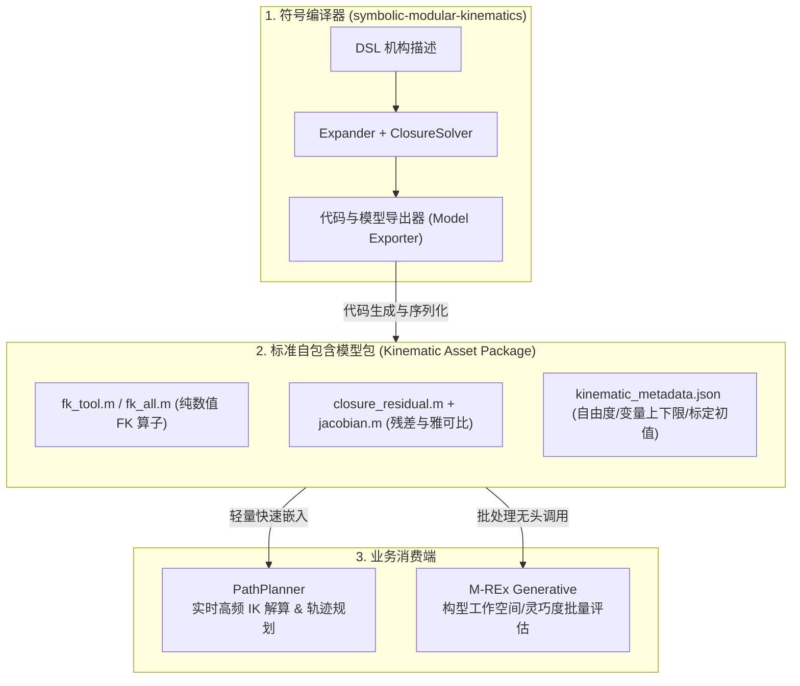

# 模型导出与外部系统集成 — 编译器 → 模型包 → 运行引擎

> 本文档是 `scripts/matlab` 的**模型导出规划与产物规范**（E1–E4），由
> [ARCHITECTURE.md](./ARCHITECTURE.md) 的「模型导出与外部系统集成架构」一节分离而来（2026-10-14）。
> 代码分层与数据流见 [ARCHITECTURE.md](./ARCHITECTURE.md)；各类 API 签名见
> [API_REFERENCE.md](./API_REFERENCE.md)；阶段规划条目（A.5.4）见
> [../../docs/project-overview.md](../../docs/project-overview.md)。

为了将本框架生成的运动学模型应用到下游系统（如 **PathPlanner** 实时路径规划、**M-REx Generative** 构型生成式评估），推荐采用 **“符号编译器 $\to$ 自包含无依赖模型包 $\to$ 运行引擎”** 的解耦设计。

## 1. 三段式职责与接口契约

| 阶段 | 输入 | 输出 | 落地位置 | 状态 |
| :--- | :--- | :--- | :--- | :--- |
| ① 符号工厂（编译器） | DSL + 模块库 + execution-config | 符号模型（`Poses` / `ResidualSym`）+ **模型包** | `solver.exportKinematics`（本仓库） | ✅ v0 已落地（2026-10-14） |
| ② 自包含模型包 | 编译器序列化的数值内核 + 元数据 | 模型包目录 | `<case>/generated/`（生成物，gitignored） | ✅ v0 已实装 |
| ③ 运行引擎（消费端） | 模型包 | IK/FK 求解服务、轨迹、批量评估 | 消费端工程（E2 可先出参考实现） | ⬜ 规划 |

接口契约（模型包消费方必须遵守）：

- **自包含**：生成的 `.m` 内核仅依赖 base MATLAB（不需要 Symbolic Math Toolbox，也不依赖本仓库代码）；
- **统一输入向量**：所有内核接收同一个 `q`（n×1 double 列向量），顺序 = `kinematic_metadata.json → inputs.names`；单位 mm / rad；输入类型（prismatic / revolute）与任务系轴向标签见 `inputs.types / inputs.axes`（v0.2），下游扫描策略由 `task_space` 自动派生；
- **零位不变量**：`q = 0` 为标定参考（闭环残差 ‖r(0)‖ ≈ 1e-15；world 锚定切口 T_bind 在零位标定）；
- **元数据是唯一机器契约**：输入顺序、切口、标定常量、工具变换、容差、frame 表均以 `kinematic_metadata.json` 为准。

---

## 2. 阶段一：符号工厂（编译器）

已有能力（A.3–A.5）：`ir.Expander`（DSL → 符号 IR）→ `ir.ExecutionConfig`（执行配置 / 变量分区）→ `solver.ClosureSolver`（闭环残差 / 世界标定 / 数值编译）——各类签名与用法见 [API_REFERENCE.md](./API_REFERENCE.md)。

**E1 落地（2026-10-14）：`solver.exportKinematics(dslYaml, execYaml, ...)`（「代码与模型导出器」入口）**：

- 一次调用完成：符号展开 → 执行配置 → 闭环残差构建 → **全部内核编译为独立 `.m` 文件** → 元数据 / README 序列化；
- 默认输出目录 = `<caseDir>/generated/`（**就地存放**：每个案例的 DSL 文件旁边）；
- 覆盖 `closed_loop`（L2 帧对切口 / L3 world 锚定切口）与 `open_loop`（FK-only）两种模式；选项：`OutputDir` / `KnownValues` / `Frames`。

> **导出暴露并修复的两个符号展开根因（2026-10-14）**：
> 1. `Expander` 的关节变量改为 `sym(name, 'real')` 创建（与既有文档意图一致）——此前无 `real` 假设时，`RigidBodyMath.invT` 的 `R'`（ctranspose）会给每个位姿引入 `conj(q)` 项，表达式膨胀且数值脆弱；
> 2. `ClosureSolver` 的切口残差改用**闭式 SE(3) 逆** `invT(T_near) * T_far`（原 `T_near \ T_far` 走行列式展开，产生 ~1e+170 系数的有理式；其平方在 double 下溢出 → `Inf − Inf = NaN`，解析雅可比在转轴关节姿态分量上出现 4 个 NaN）。修复后：残差内核提速 ~8.6×（507 → 59 µs/次），解析雅可比全有限（12×8，与中心差分一致 ~5e-9），既有 + 新增共 12 个 pipeline 测试全量回归全绿。

**E1 v0.2（2026-10-15）：泛化任务空间元数据** —— 导出时新增 `solver.TaskSpaceAnalyzer` 的瞬时分析（纯数值，零位探针，中央差分）：

- `inputs.types`（逐输入 `prismatic` / `revolute`，源自 Expander 关节记录）与 `inputs.axes`（任务系运动轴标签：棱柱与 ±x/±y/±z 对齐记 `x`/`y`/`z`，其余方向按平行聚类 `u#`；旋转按方向聚类 `r#`。例：mrex-3t1r_001 → `["x" "y" "z" "x" "y" "z" "r1" "r1"]`）；
- `task_space {mobility, rotation {mode, axis}, dims, probe}`：mobility = "NtMr" 一阶分解（t = 纯平动子空间维数，r = 角速度投影秩；r = 1 时 mode = axis 给出任务系旋转轴）；`probe` 记录零位探针 q、物理环约束秩与流形维数。
- **关键点（流形分析对象）**：world 锚定切口的导出残差是「双 ground 各自钉零位标定」形式，12 分量对 8 未知量过定（其 Jacobian 满列秩），**不能**用于流形 / 机动度分析；必须使用 ground-ground **相对约束** $T_{near,1}^{-1}T_{near,2} = G_1^{-1}G_2$。实测 mrex-3t1r_001：相对约束秩 4 → 流形 4 维，任务旋量空间 = 3 平移 ⊕ 1 旋转（轴 $[1\,0\,1]/\sqrt{2}$，任务系），零位与已解可行点结果一致。
- **消费端联动**：`mrex_generative` 的 `mrex.ConfigGenerator` 以 `task_space` 自动派生扫描轴向与旋转轴（policy `families` 降级为后备 / `"override": true` 显式覆盖），以 `inputs.types/axes` 支持按类型 / 轴向标签匹配限位规则 —— dsl → 导出 → 工作空间评估全链路无需逐机构手工规则。

---

## 3. 阶段二：自包含模型包 —— 产物规范（v0 已实装）

**存放位置**：`specs/dsl/cases/<case>/generated/`（就地；生成物不入库，`.gitignore` 规则 `specs/dsl/cases/*/generated/`；如需交付固定版本，另行 `git add -f` 或归档）。

**文件清单（每次导出整体重写）**：

| 文件 | 适用模式 | 签名 | 语义 |
| :--- | :--- | :--- | :--- |
| `README.md` | 全部 | — | 生成包文档：输入表、文件签名、用法示例、来源快照 |
| `kinematic_metadata.json` | 全部 | — | 机器可读契约（见下） |
| `closure_residual.m` | closed_loop | `r = closure_residual(q)` | 6-DOF 闭环残差（`‖r‖ ≈ 0` ⟺ 闭环；mm / rad） |
| `closure_residual_jacobian.m` | closed_loop | `J = closure_residual_jacobian(q)` | 解析雅可比 $\partial r/\partial q$（编译自 `sym/jacobian`） |
| `fk_tool.m` | 全部 | `D = fk_tool(q)` | 任务位姿 4×4：L3 world 模式 = `U⁻¹ · T_bind · T_near(q)⁻¹ · U`（与 `evalToolPose` 同式）；L2 / open_loop = root 锚定 endFrame 位姿 |
| `fk_all.m` + `fk_all_matrix.m` | 全部 | `poses = fk_all(q)` | 全体 frame 位姿（struct；`fk_all_matrix` 为 (4N)×4 原始内核） |

**kinematic_metadata.json 关键字段**：`mechanism / mode / direction / end_frame / units`、`sources`（dsl、execution-config、模块库路径）、`inputs {kind, names, count, types, axes}`（v0.2 起含类型与任务系轴向标签）、`known_joint_values`、`closure {source, num_cuts, num_components, cuts[]（near / far / anchor / components / T_mate / T_bind）}`、`tolerances`、`task_frame {framing, end_frame, reference_ground, tool_conjugated, U}`、`task_space {mobility, rotation {mode, axis}, dims {task, translation, rotation}, probe {q, constraint_rank, manifold_dim}}`（v0.2 泛化元数据，见 §2 末）、`mechanism_stats`、`frames[] {index, node, field}`（fk_all 行块 ↔ 字段映射）、`functions`（各内核签名与输出尺寸）。

**实测（mrex-3t1r_001，MATLAB R2026a 无头）**：导出总耗时 ~2.8 s；8 输入 / 12 分量 / 96 frames；`closure_residual` vs `ClosureSolver.evalResidual` 偏差 7.8e-15；`fk_tool` vs `evalToolPose` 8.4e-15；`fk_all` 抽检 ≤ 8e-15；残差内核单次求值 ~59 µs。

---

## 4. 阶段三：运行引擎（消费端）—— 规划（未实现）

目标：把模型包变成「不依赖符号工具箱、不依赖本仓库」的最小运行服务；消费方只按第 1 节的接口契约读取模型包。下面两个消费场景定义了运行引擎的验收目标（E2 先出参考实现，集成留 E3）。

### 消费场景 ①：PathPlanner（替代慢速 Simulink 逆向仿真）

[PathPlanner](../../docs/reference/pathplanner-architecture.md) 在轨迹执行时需要以 $50\sim 200\,\text{Hz}$ 高频执行逆解算（IK），其核心要求是**低延迟、无大型符号库依赖、自包含**。

- **架构改造**：
  1. **静态代码导出（E1 已落地）**：`solver.exportKinematics` 已把残差、解析雅可比与 FK 直接生成为独立 `.m` 函数（产物规范见第 3 节）；C 代码（MATLAB Coder）导出留待 E4。
  2. **轻量求解器封装 (`StandaloneSolver`)**：
     编写一个不依赖 `Expander` 和 Symbolic Toolbox 的轻量类，内部仅包含上述导出的纯数值矩阵函数，配合高斯-牛顿法（Gauss-Newton）或信赖域法迭代：
     $$\Delta x = -(J_r^T J_r + \lambda I)^{-1} J_r^T r(x)$$
  3. **实时热启动（Warm-start）**：
     在连续轨迹跟踪中，上一周期的关节解 $q_{t-1}$ 直接作为当前周期 $q_t$ 的初始猜想，通常 $1\sim 2$ 步迭代即可收敛至 $< 10^{-6}\,\text{mm}$，耗时 $< 0.5\,\text{ms}$，彻底替代原有的 Simulink 物理仿真逆解，使控制环路具备硬实时确定性。

### 消费场景 ②：M-REx Generative（构型设计空间评估）

生成式设计系统需要对成百上千种自动化生成的候选机构拓扑进行多指标筛选与工作空间评估。

- **架构流程（无头批处理流水线）**：
  1. **流水线统一接口（E1 已落地）**：
     无头批处理入口 `out = solver.exportKinematics(dslYaml, execConfigPath)` 一键完成 DSL 展开、闭环残差提取与雅可比解析求导 $J(q) = \frac{\partial r}{\partial q}$，产出标准模型包（默认就地写入 `<case>/generated/`）。
  2. **工作空间蒙特卡洛与切片采样**：
     - 利用编译后的 `evalToolPose` 或 `PoseFuncs_`，在主动关节极限范围 $[q_{min}, q_{max}]$ 内均匀网格采样或边界追踪；
     - 判定残差 $\|r(q)\| < \epsilon$（滤除物理不可达位形），快速提取末端点云，计算工作空间凸包体积（Workspace Volume）。
  3. **灵巧度与奇异性指标评估**：
     - 结合任务雅可比 $J_{task}$ 与约束雅可比 $J_{closure}$，在流形切空间中计算 Yoshikawa 灵巧度指标：
       $$w = \sqrt{\det(J_{task} J_{task}^T)}$$
     - 评估全域条件数 $\kappa(J)$，定位机构奇异形位。
  4. **指标打标与筛选**：
     将评估结果汇总为 `evaluation_scorecard.json`，直接作为遗传算法、强化学习或多目标搜索（Pareto 前沿）的适应度反馈。

## 5. 实施路线（E1–E4）

| 里程碑 | 内容 | 状态 |
| :--- | :--- | :--- |
| **E1** 导出器 v0 | `solver.exportKinematics` → 自包含模型包（residual / jacobian / fk_tool / fk_all / metadata / README）；三案例导出测试全绿 | ✅ 2026-10-14 |
| **E1 v0.2** 泛化任务空间元数据 | `solver.TaskSpaceAnalyzer` → 导出新增 `inputs.types/axes` + `task_space{mobility, rotation, dims, probe}`；mrex_generative 据此自动生成评估 config（dsl → 导出 → 评估全链路打通） | ✅ 2026-10-15 |
| **E2-P0** 运行时内核 | `solver.KinematicsRuntime`（target-aware LM IK + warm-start + 运行时 tool frame + 驱动-only FK）+ `solver.exportDeployment`（命名空间内核 + `smk.KinematicsRuntime` + manifest）；v00 端到端测试全绿 | ✅ 2026-10-20 |
| **E2-P1** 轨迹/限位/部署包装 | `ikTrajectory`（批量 warm-start + 分支跳变/限位诊断）、`setLimits` / `Limits` 元数据、`IK_<name>.m` / `FK_<name>.m` 顶层包装 | ✅ 2026-10-20 |
| **E2** 运行引擎原型 | 无符号工具箱的最小运行类（GN/LM + warm-start）+ 模型包回放校验（轨迹残差 < 容差、与 fmincon 对照） | 🔄 P0/P1 已完成，解析被动雅可比 / 流形投影待补 |
| **E3** 消费端集成 | PathPlanner `onCalcIK` / `onCalcFK` 替换（A.7.1）；M-REx Generative 采样 / 灵巧度评估 | ⬜ |
| **E4** 介质扩展 | C-MEX / MATLAB Coder 构建、JSON 抽象计算图（跨语言）、模型包版本化交付（tag / 归档） | ⬜ |

---

## 附录：导出介质对比（E4 选型参考）

| 导出介质 | 优点 | 局限性 | 适用场景 |
| :--- | :--- | :--- | :--- |
| **纯 MATLAB `.m` 脚本** | 开箱即用，与现有测试脚本无缝兼容，调试直观。 | 仍依赖 MATLAB 运行时环境。 | PathPlanner 原型验证、离线仿真。 |
| **C / C-MEX 动态库** | 运算压至微秒级，完全独立，内存开销极小。 | 需要构建编译链（MATLAB Coder）。 | 实车主控板嵌入、C++ 实时控制核心。 |
| **JSON / 抽象计算图** | 跨语言通用（Python / C++ / Web），适合符号重构。 | 下游需实现解析与自动微分引擎。 | M-REx Generative 结合 PyTorch/CasADi 训练。 |

## 相关文档

| 文档 | 内容 |
|------|------|
| [ARCHITECTURE.md](./ARCHITECTURE.md) | +core / +ir / +solver / +viz 代码分层、数据流、设计决策 |
| [API_REFERENCE.md](./API_REFERENCE.md) | `solver.exportKinematics` / `solver.ClosureSolver` 等 API 签名 |
| [../../docs/project-overview.md](../../docs/project-overview.md) | 阶段规划（A.5.4 模型导出与运行引擎） |
| [../../docs/reference/pathplanner-architecture.md](../../docs/reference/pathplanner-architecture.md) | 消费端（PathPlanner）背景参考 |
| `specs/dsl/cases/<case>/generated/` | 就地模型包产物（gitignored 生成物，可直接查看示例） |
