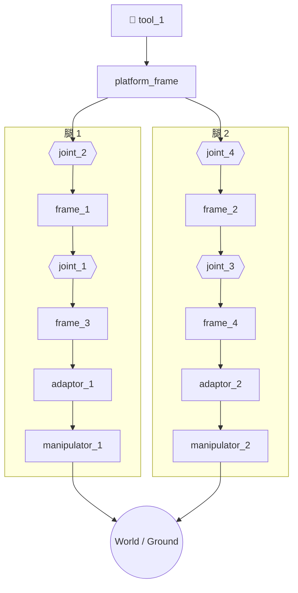

# candidate_3t2r_attempt_03 — 3t2r 两腿并联机构（候选 03/12）

> 由 `mrex_modularization` 生成的装配候选 attempt 3（family strict，riser k=0），
> 与 `python -m cli describe … --attempt 3` 的输出一致（确定性，同输入同输出）。

## 结构概述

两腿并联机构：每腿一台 3-DOF 笛卡尔 **Manipulator** 驱动，经 45° **Adaptor**、刚性
**Frame** 与两个 **Joint**（腿内 U 副，两铰轴 90° 交叉）接至平台 **Frame**；平台承载
🧪 **ToolPipette**（FK 根）。候选 3（默认长度，无伸长段），共 14 个模块。

两腿互为平移副本：驱动轴系一致；两台驱动左右沿世界 y（span (0, -40, 0) mm）；Adaptor
体 +Z 上仰 45°（45° 楔块在 90° 装配晶格上的可达上限）。装配呈 L3 世界系闭环
（两驱动 ground 收束到 World），零位 q = 0。

## 装配流程图



> **阅读方式**：工具置顶，向下经平台分入两条支链；每条支链自上而下是
> `Joint → Frame → Joint → Frame`（腿内 U 副）与 Adaptor、Manipulator（驱动置底），
> Pin 不上节点、只标注在连接边上；两驱动最终收束到同一 World。

## 符号变量表

| 变量（实例限定名） | 含义 | 单位 | 属性 |
|---|---|---|---|
| `joint_2.q` | 腿 1 平台侧铰角 | rad | observable |
| `joint_1.q` | 腿 1 车架侧铰角 | rad | observable |
| `joint_4.q` | 腿 2 平台侧铰角 | rad | observable |
| `joint_3.q` | 腿 2 车架侧铰角 | rad | observable |
| `manipulator_1.dx / .dy / .dz` | 腿 1 驱动三向滑台位移 | mm | observable |
| `manipulator_2.dx / .dy / .dz` | 腿 2 驱动三向滑台位移 | mm | observable |

> L3 执行层的 known / unknown 分区未定义（execution-config 待引擎 A.4b）。

## 说明 / 备注

- 候选元数据（生成自 `wiring.json` → `candidate`）：attempt 03/12、
  riser_frames_per_leg=0、角面 leg1=faceZPlus /
  leg2=faceZMinus、rolls leg1=[1, 3, 0, 0, 3, 0] /
  leg2=[1, 1, 0, 0, 1, 0]、tool spin roll=3、
  span (0, -40, 0) mm、adaptor_z_up=true。
- 引擎状态：本层（k=0）全部 4 个候选（attempt 00–03）已实跑：14 实例 / 13 连接 / 82 帧全放置 / 13 mates gap=0 mm（2026-10-16，MATLAB R2025b）。
- 运行（result.json 写入本目录）：

  ```bash
  python -m cli engine-run --case <本目录>
  # 或：matlab -batch "addpath(genpath('<engine>/scripts/matlab')); run_modularization_case('<本目录>');"
  ```
