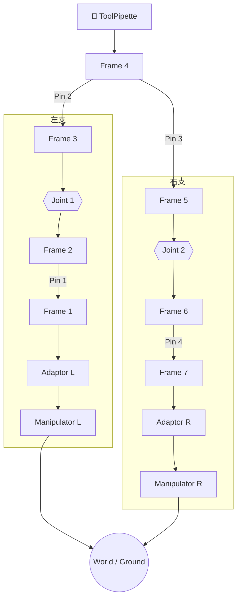

# mrex-3t1r_001 — 3T1R M-REx 机构

> 阶段 A.2.3 验证目标：两端 Manipulator 驱动的闭环链 FK/IK 传播、多模块串联与分支。

## 结构概述

两端各一个 **Manipulator**（3-DOF 笛卡尔驱动，dx/dy/dz）经 **Adaptor** 接入 M-REx 单元链。中间通过 **Pin**（Connector 销钉连接件）连接 **Frame** 立方体，串联两个 revolute **Joint** 构成主运动链。**ToolPipette** 作为工具末端从 Frame_4 分支，提供 `tip_origin` 观测点。

机构在零位构型下，末端效应器（`ToolPipette.tip_origin`）与世界原点重合（$T=I_4$）；两端 `Manipulator` 的 `ground` frame 各带静态标定偏移绑定到 `world`。Manipulator 关节（dx/dy/dz）在零位时机构自洽，运行时通过调节关节变量来满足末端任务位姿，形成典型的 **3T1R**（三平移一转动）M-REx 构型。

## 装配流程图

> 绘制规则见下方 [§ 绘制规则](#绘制规则)。以下按规则绘制 mrex-3t1r_001 的运动链图。

> **阅读方式**：从顶部工具向下看。左右两支用 `subgraph` 分别封装，`direction TB` 保证支链内部自上而下，`~~~` 跨 subgraph 对齐关节层和驱动层。Pin 不作为节点出现，而是标注在连接边上（`-->|Pin N|`）。最底层两个 Manipulator 收束到同一个 `World / Ground` 节点展示**闭环**概念。

---

## 符号变量表

| 变量（实例限定名） | 含义 | 单位 | 属性 |
|---|---|---|---|
| `manipulator_L.dx` | 左驱动 X 轴平移 | mm | observable |
| `manipulator_L.dy` | 左驱动 Y 轴平移 | mm | observable |
| `manipulator_L.dz` | 左驱动 Z 轴平移 | mm | observable |
| `manipulator_R.dx` | 右驱动 X 轴平移 | mm | observable |
| `manipulator_R.dy` | 右驱动 Y 轴平移 | mm | observable |
| `manipulator_R.dz` | 右驱动 Z 轴平移 | mm | observable |
| `joint_1.q` | 第一转动副角度 | rad | observable |
| `joint_2.q` | 第二转动副角度 | rad | observable |
| `pipette.tip_origin` | 工具尖端任务系 | — | observable（FK/IK 输出候选） |

## L3 执行层（execution-config）

`execution-config.yaml` 把本机构接入 L3 世界系闭环——**案例唯一运行配置**（3T1R 全任务空间）：

- **模式**：`closed_loop` IK——`known` = `pipette.tip_origin`（目标位姿载体）；
  `unknown` = 6 个 Manipulator 笛卡尔驱动位移（`dx/dy/dz`）+ 内部关节 `joint_1.q` / `joint_2.q`
  → 8 未知量 / 12 残差分量（2 切口 × 6）。
- **切口**：每条 Manipulator 的 `ground` frame 以 `anchor: world` 锚定到其 `world_binding`
  标定位姿（残差取 M = I₄、far 为常量；语义见
  [`connection-semantics.md`](../../connection-semantics.md) §6.4）。
- **标定**：`world_binding` 省略 `T`，由 `solver.ClosureSolver` 在零位构型下自动标定。
- **工具坐标系**：默认声明 `tool_frame`（`rpy: [0, 45deg, 0]`）→ 世界系 ≡ 工具系零位
  （pipette tip 初始倾斜 −45°）；全部用户面目标位姿以工具系表达，用法与开关见下节。
- **历史**：A.4b 曾用 6 未知量 3T 基线配置（内部关节 known、`components: [tx, ty, tz]`）；
  A.5.1 释放内部关节后其能力被本配置覆盖，基线配置于 2026-10-11 配置合并中移除——其
  KNOWNVALUES / 方形 6×6 基线覆盖保留在测试 tmp fixture 中。

端到端验证：`tests/pipeline/test_closure_solver_m_rex_3t1r.m`（需 Symbolic Math Toolbox；
以 `tests/pipeline` 为工作目录运行）。实测结果（2026-10-11，8 未知量 / 12 分量）：

| 检查项 | 结果 |
|------|------|
| 零位残差 | 6.3e-16（< 1e-12） |
| 约束 Jacobian（零位，12×8） | rank 8/8 满列秩，cond = 227 |
| 3T 基线 fixture（6×6） | rank 6/6，cond = 1.0，J ≡ I₆（A.4b 指标复现） |
| 平移 IK（±X/±Y/±Z，5–10 mm）与 Rx 10° | 零初值一次收敛，‖r‖ ≈ 8e-13…1.3e-10 |
| Rx 铰链解 | q1 = +φ、q2 = −φ（与 ±φ 偏差 9.6e-14） |
| world-rooted 交叉验证（+X 10 mm） | 两分支 ‖E−ΔT‖ ≈ 1e-9…6e-9（全 6 分量） |
| Ry 2°（任务流形外） | 正确拒绝（‖r‖ = 4.9e-2，偏差 1.391） |

> **DOF 发现（A.4b → A.5.1）**：`joint_1.q` / `joint_2.q` 视为已知时机构仅保留 3 个平移
> 自由度——纯转动目标无法满足（Ry 2° 的 tip 位姿偏差 1.391）。释放内部关节移入 `unknown`
> 后获得完整 3T1R 能力；本案例现以该表述为唯一配置。

## 动画（A.5.1 / A.5.2.0）

分层播放（A.5.2.0 起，推荐）：`solver.buildPoseSequence(e, Q, names, 'Anchor', 'tool'|'world', 'ToolTransform', U)`
→ `viz.sceneSpec(e)` → `viz.play(seq, scene, 'Fps', 15)`（figure 中 ▶ Play 播放）；兼容包装
`viz.animate(...)` 签名不变。端到端测试与轨迹生成：`tests/pipeline/test_animation_m_rex_3t1r.m`
（全绿；`'Anchor','tool'` 工具系世界显示 + 工具系 triad，pipette 零位可见 −45° 倾角）。

**demo 轨迹的规定位置**：轨迹不在任何 `execution-config*.yaml` 里——它由测试脚本顶部参数区定义，
经闭式构造展开成关节轨迹矩阵 `Q` 后传入动画/求解器（与 single-closed-loop 测试内联轨迹同例）：

- φ（tip 绕 X 旋转）：−14° → +14°（14° 按实机行程 X/Y ±10 mm、Z ±15 mm 标定；16° 时 dy 会达 10.4 mm）
- 位姿平移：XY 平面圆，半径 4 mm，一圈；θ(ry) = ψ(rz) = 0 锁定 —— RCM (x, y, z, φ) 任务模式
- 60 帧 @ 30 fps

**闭式构造（无 IK）**：

$$q_1 = \varphi,\quad q_2 = -\varphi,\qquad
\mathbf{d}_{L/R} = R_{\text{bind}}^{\top}\bigl(\mathbf{p}(t) - \mathbf{p}_{\text{swing}}^{L/R}(\mp\varphi)\bigr)$$

其中 $R_{\text{bind}} = \mathrm{rot}(P_L) = \mathrm{rot}(P_R)$（两侧 binding 旋转相同），
$\mathbf{p}_{\text{swing}}$ 为单铰链偏转、Manipulator 零位时的 tip 世界位置（编译位姿函数求值）。

实测（`test_animation_m_rex_3t1r.m`）：

| 检查项 | 结果 |
|------|------|
| 闭式轨迹 vs 目标（60 帧，全 6 自由度） | max‖E−D‖ = 1.9e-14 |
| ClosureSolver 残差（全 12 分量，采样 5 帧） | max\|r\| = 1.7e-14（无 NaN） |
| Manipulator 行程 | \|dx\|≤6.98、\|dy\|≤9.54、\|dz\|≤5.51 mm（≤ ±10/±10/±15） |
| 动画分支一致性（两 ground 互差） | max = 2.2e-14 |

> `execution-config.yaml`（原 `execution-config-3t1r.yaml`，配置合并后更名）= 3T1R
> **全任务空间**执行配置（`unknown` 含两个内部关节、`components` 全 12 分量）——供求解器侧
> 残差验证与 IK 使用；只规定 L3 执行语义，不含轨迹。
> 原 6 未知量 3T 基线配置（A.4b）已于 2026-10-11 配置合并中移除（覆盖迁移至测试 fixture）。

## 工具坐标系（A.5.1.5，本案例已声明）

本案例的 `execution-config.yaml` **默认声明** `tool_frame`（`rpy: [0, 45deg, 0]`）——
作为「工具系零位与世界系对齐 + pipette tip 初始倾斜 −45°」的参考用法：

- **语义**：声明后「世界系 ≡ 工具坐标系零位姿态」。工具系零位姿态 = $I_4$（初始方向与
  世界系平行）；pipette tip（`endFrame`）零位姿态自动派生为 $U^{-1} = Ry(-45°)$（即设计例
  `0,0,0,0,-45°,0`），其中 $U = T_{\text{root}\leftarrow\text{tool}} =
  T_{\text{endFrame}\leftarrow\text{tool}} = Ry(45°)$（root = endFrame = `pipette.tip_origin`）。
- **用法**：目标位姿经 `ClosureSolver.setToolTarget(Δ)` 输入（左乘世界系增量，内部共轭
  $\Delta T_{\text{tip}} = U\cdot\Delta\cdot U^{-1}$）；位姿报告经 `ClosureSolver.evalToolPose(q)` 输出。
  tip 级旧接口 `setTipTarget` 不受影响（两者未声明 tool_frame 时完全一致）。
- **开关**：删除/注释 `execution-config.yaml` 中的 `tool_frame` 块即回到历史行为
  （世界系 ≡ tip 零位，$U = I_4$，`setToolTarget` ≡ `setTipTarget`）。
- 语义细节见 [`connection-semantics.md`](../../connection-semantics.md) §6.5；端到端验证：
  `tests/pipeline/test_tool_frame_m_rex_3t1r.m`（[1] 案例声明 / [2] 剥离后回归 / [7] 工具系 IK）。

## 说明

- 两端 Manipulator 的 ground frame 如何绑定到 world、哪个 Manipulator 作为驱动/被动、`endFrame` 指定、变量 `known/unknown` 分区均属 **L3 execution-config**，不在本 DSL 中声明。
- 全部关节零位（q=0, dx=dy=dz=0）满足建模约定 §2.4 初始零位条件。
