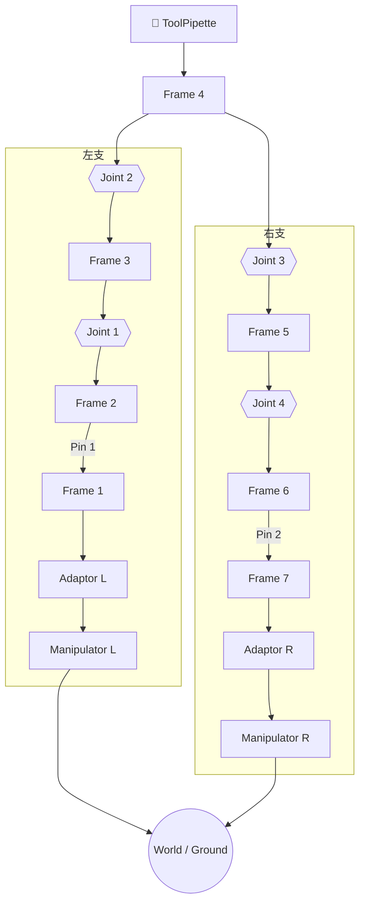

# mrex_3t2r_001 — 3T2R M-REx 机构

> 3T1R 主体构型 [mrex_3t1r_001](../mrex-3t1r_001/README.md) 的 **3T2R 变体**：主运动链串联四个内置
> revolute 关节（joint_1…joint_4，零位轴向 Z-Y-Y-Z），由两端 Manipulator 笛卡尔驱动构成世界系闭环；
> 零位任务空间实测 mobility `3t2r`（3 平移 ⊕ 2 转动，rotation full），见 [§ L3 执行层](#l3-执行层execution-config)。

## 结构概述

两端各一个 **Manipulator**（3-DOF 笛卡尔驱动，dx/dy/dz）经 **Adaptor** 接入 M-REx 单元链。主运动链为
**Frame_2 → Joint_1(Z) → Frame_3 → Joint_2(Y) → Frame_4 → Joint_3(Y) → Frame_5 → Joint_4(Z) → Frame_6**
的四关节串接（相比 3T1R 版的双关节 Y-Y 链多出一对 Z/Y 关节，任务空间扩展出第二个转动自由度）；
**ToolPipette** 从 Frame_4 分支提供 `tip_origin` 观测点；左端 Frame_1↔Frame_2、右端 Frame_6↔Frame_7
各经一个 **Pin**（Connector 销钉连接件）连接。

机构在零位构型下，末端效应器（`ToolPipette.tip_origin`）与世界原点重合（$T=I_4$）；两端 `Manipulator`
的 `ground` frame 各带静态标定偏移绑定到 `world`。运行时通过 6 个驱动位移 + 4 个内部关节共同满足末端
任务位姿，形成典型的 **3T2R**（三平移两转动）闭链构型。

## 装配流程图

> 绘制规则见 [`case-conventions.md`](../../case-conventions.md) § 装配流程图绘制规则。以下按规则绘制 mrex_3t2r_001 的运动链图。

> **阅读方式**：从顶部工具向下看。左右两支用 `subgraph` 分别封装，`direction TB` 保证支链内部自上而下；
> 四个 Joint 分两层跨支对齐（Joint 2/3 一层、Joint 1/4 一层，`~~~`）。Pin 不作为节点出现，而是标注在
> 连接边上（`-->|Pin N|`）。最底层两个 Manipulator 收束到同一个 `World / Ground` 节点展示**闭环**概念。

---

## 符号变量表

| 变量（实例限定名） | 含义 | 单位 | 属性 |
|---|---|---|---|
| `manipulator_L.dx` | 左驱动 X 轴平移 | mm | observable |
| `manipulator_L.dy` | 左驱动 Y 轴平移 | mm | observable |
| `manipulator_L.dz` | 左驱动 Z 轴平移 | mm | observable |
| `manipulator_R.dx` | 右驱动 X 轴平移 | mm | observable |
| `manipulator_R.dy` | 右驱动 Y 轴平移 | mm | observable |
| `manipulator_R.dz` | 右驱动 Z 轴平移 | mm | observable |
| `joint_1.q` | 转动副 1（Frame_2 ↔ Frame_3，零位轴向 Z） | rad | observable |
| `joint_2.q` | 转动副 2（Frame_3 ↔ Frame_4，零位轴向 Y） | rad | observable |
| `joint_3.q` | 转动副 3（Frame_4 ↔ Frame_5，零位轴向 Y） | rad | observable |
| `joint_4.q` | 转动副 4（Frame_5 ↔ Frame_6，零位轴向 Z） | rad | observable |
| `pipette.tip_origin` | 工具尖端任务系 | — | observable（FK/IK 输出候选） |

## L3 执行层（execution-config）

`execution-config.yaml` 把本机构接入 L3 世界系闭环——**案例唯一运行配置**（3T2R 全任务空间）：

- **模式**：`closed_loop` IK——`known` = `pipette.tip_origin`（目标位姿载体）；
  `unknown` = 6 个 Manipulator 笛卡尔驱动位移（`dx/dy/dz`）+ 全部 4 个内部关节
  （`joint_1.q` … `joint_4.q`）→ **10 未知量 / 12 残差分量**（2 切口 × 6）。
- **切口**：每条 Manipulator 的 `ground` frame 以 `anchor: world` 锚定到其 `world_binding`
  标定位姿（残差取 M = I₄、far 为常量；语义见
  [`connection-semantics.md`](../../connection-semantics.md) §6.4）。
- **标定**：`world_binding` 省略 `T`，由 `solver.ClosureSolver` 在零位构型下自动标定。
- **工具坐标系**：默认声明 `tool_frame`（`rpy: [0, 45deg, 0]`，与 `mrex_3t1r_001` 同款倾斜参考用法）
  → 世界系 ≡ 工具系零位姿态；全部用户面目标位姿 / 位姿报告以工具系表达（`setToolTarget` /
  `evalToolPose`，语义见 `connection-semantics.md` §6.5）。删除/注释该块即回到历史行为（U = I₄）。

零位实测（2026-10-15，MATLAB R2026a 无头；10 未知量 / 12 分量）：

| 检查项 | 结果 |
|------|------|
| 零位残差 | 1.1e-14（< 1e-12） |
| 约束 Jacobian（零位，12×10） | rank 10/10 满列秩（奇异值范围 0.0385 … 26.0） |
| 任务空间（`solver.TaskSpaceAnalyzer` 零位探针） | mobility **`3t2r`**（3 平移 ⊕ 2 转动）；rotation `full`；流形维数 5；任务系输入轴标签 `[x y z x y z r1 r2 r2 r1]` |
| 零位 tip 位姿 | `pipette.tip_origin` = $I_4$（世界原点、姿态与世界系平行） |
| tool_frame 解析（`ClosureSolver.ToolTransform`） | $U = Ry(45°)$ |
| 模型导出（`solver.exportKinematics`） | 7.7 s；10 输入 / 102 frames / 12 分量（产物见 `generated/`，gitignored） |

> 说明：IK 轨迹 / 动画等端到端验证尚未编写；可参照
> `tests/pipeline/test_closure_solver_m_rex_3t1r.m` 与 `tests/pipeline/test_export_kinematics_m_rex_3t1r.m`
> 的框架为本案例扩展。

## 说明

- **与 `mrex_3t1r_001` 的差异**：主运动链由 2 个（Y-Y）扩展为 **4 个内置转动关节（Z-Y-Y-Z）**，
  `unknown` 由 8 → **10**；任务空间由 3T1R（单一旋转轴）扩展为 **3T2R（rotation `full`）**；
  Pin 由 4 个精简为 2 个；每个 Joint 的 `linkA/linkB` 位置与零位轴向详见装配流程图与符号变量表。
- 两端 Manipulator 的 ground frame 绑定、`endFrame` 指定、变量 `known/unknown` 分区均属
  **L3 execution-config**，不在 DSL 中声明。
- 全部关节零位（q=0, dx=dy=dz=0）满足建模约定 §2.4 初始零位条件（零位残差 1.1e-14 实测自洽）。
