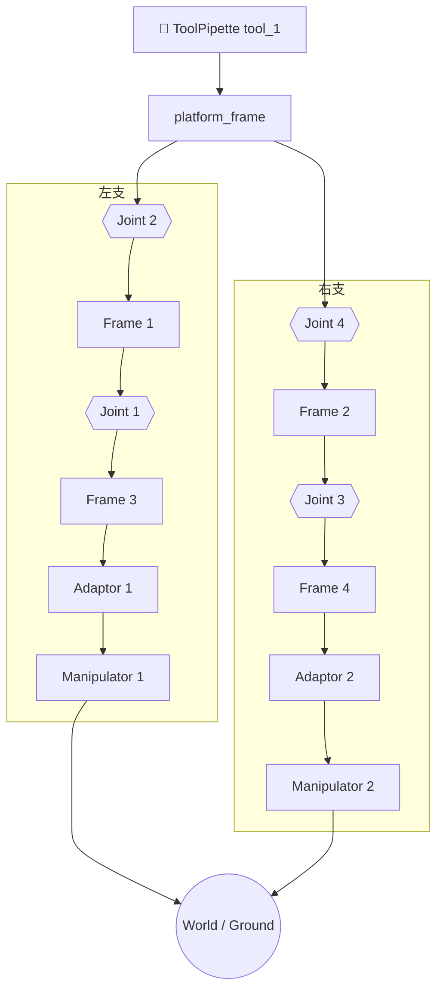

# mrex_3t2r_v03 — 3T2R M-REx 变体（stage C，评估用）

> 由 `mrex_modularization`（stage C）生成的 3T2R M-REx 装配变体。与 k01 系列共用
> 同一执行配置模板（10 未知量 / 12 残差分量、tool frame `Ry(45°)`）；本目录已附带
> 可被 `mrex_generative` 直接消费的 `generated/` 模型包。

## 结构概述

两端各一个 **Manipulator**（3-DOF 笛卡尔驱动，`dx/dy/dz`）经 **Adaptor** 接入
M-REx 单元链；主运动链由 4 个 revolute **Joint**（`joint_1` … `joint_4`）串接
`Frame 1/2/3/4` 组成，`platform_frame` 汇聚左右两支并分支到 **ToolPipette**
（`tool_1`），提供 `tip_origin` 观测点。零位下 `tool_1.tip_origin` 与世界原点重合
（$T=I_4$），两个 Manipulator 的 `ground` frame 各带静态标定偏移绑定到 `world`，
形成 L3 世界系闭环。

与 `mrex_3t2r_k01_a0` 的主要装配差异：

- 两条 platform 侧 Joint 均为 **`roll: 0`**（k01_a0 为 `roll: 1`）
- 两侧 Manipulator dock 均为 **`roll: 2`**（k01_a0 无 roll）
- `adaptor_1.pin_connector_A ↔ frame_3.faceYMinus`（k01_a0 为
  `pin_connector_B ↔ faceZMinus` + `roll: 1`）
- `adaptor_2.pin_connector_B ↔ frame_4.faceYMinus`（`roll: 2`；k01_a0 为
  `faceZMinus` + `roll: 3`）

因此零位标定矩阵 $T_{\text{bind}}$ 与 k01_a0/v01 不同，评估时必须使用本目录
重新导出的模型包，不能复用其他变体的 `generated/`。

## 装配流程图



> **阅读方式**：从顶部工具向下看。`platform_frame` 将左右两支横向展开；Joint 层
> 跨支对齐（Joint 2/4、Joint 1/3），最底层两个 Manipulator 收束到同一个
> `World / Ground` 节点展示闭环。本变体不含 Pin 模块，Adaptor 直接对接 Frame。

## 符号变量表

| 变量（实例限定名） | 含义 | 单位 | 属性 |
|---|---|---|---|
| `manipulator_1.dx` / `dy` / `dz` | 左驱动 X/Y/Z 轴平移 | mm | unknown |
| `manipulator_2.dx` / `dy` / `dz` | 右驱动 X/Y/Z 轴平移 | mm | unknown |
| `joint_1.q` | 转动副 1 | rad | unknown |
| `joint_2.q` | 转动副 2 | rad | unknown |
| `joint_3.q` | 转动副 3 | rad | unknown |
| `joint_4.q` | 转动副 4 | rad | unknown |
| `tool_1.tip_origin` | 工具尖端任务系 | — | known（IK 目标位姿载体） |

输入向量顺序 = 上表 10 个 unknown（先 6 个 prismatic，后 4 个 revolute），与
`generated/kinematic_metadata.json → inputs.names` 完全一致。

## L3 执行层（execution-config）

`execution-config.yaml` 将本机构接入 L3 世界系闭环：

- **模式**：`closed_loop` IK；`known` = `tool_1.tip_origin`，`unknown` = 6 个
  Manipulator 驱动位移 + `joint_1..4.q` → **10 未知量 / 12 残差分量**。
- **切口**：`manipulator_1.ground` / `manipulator_2.ground` 各以 `anchor: world`
  锚定到其 `world_binding` 标定位姿（`T` 省略，由零位构型自动标定）。
- **工具坐标系**：`tool_frame` 声明 `rpy: [0, 45deg, 0]`，世界系 ≡ 工具系零位姿态
  （$U = Ry(45°)$），与 `mrex_3t2r_001` / k01 / v01 系列保持一致。

## 零位验证（2026-10-18，MATLAB R2026a）

| 检查项 | 结果 |
|------|------|
| 零位残差 $\lVert r(0) \rVert$ | **1.5e-14**（12 分量） |
| 解析 Jacobian（12×10） | rank **10/10**，cond ≈ **368**，全部有限 |
| `fk_tool(0)` | $I_4$（偏差 3.6e-15） |
| 任务空间（`solver.TaskSpaceAnalyzer`） | mobility **`3t2r`**，rotation `full`，流形维数 **5** |
| 输入轴标签（任务系） | `[x y z x y z r1 r2 r1 r2]` |
| 规模 | 14 instances / 162 edges / 82 frames |
| 模型导出 | 7 个文件，≈21 s |

下游 `mrex.GeneratedKinematics` 冒烟（同一 `generated/`）：

| 检查项 | 结果 |
|------|------|
| `ik(eye(4))` | `ok = true`，残差 1.2e-14 |
| `ik(+5 mm, X)` | `ok = true`，残差 4.0e-13 |
| `fk(ik(T))` 回代 | 与目标位姿偏差 9.5e-12 |

> 该冒烟只验证 IK/FK 数值链路，不含执行器行程限位；限位过滤由
> `mrex.KinematicsAdapter` / `WorkspaceEvaluator` 在评估时施加。

## generated/ 模型包

`generated/` 由 `solver.exportKinematics` 就地生成（package format v0.2，
`generated_at: 2026-10-18 14:05:54`）：

| 文件 | 签名 | 语义 |
|------|------|------|
| `kinematic_metadata.json` | — | 机器契约：输入顺序、`T_bind`、`U`、task_space、容差、frame 表 |
| `closure_residual.m` | `r = closure_residual(q)` | 12×1 闭环残差（mm / rad） |
| `closure_residual_jacobian.m` | `J = closure_residual_jacobian(q)` | 12×10 解析 Jacobian |
| `fk_tool.m` | `D = fk_tool(q)` | 工具位姿 4×4（世界 ≡ 工具系零位） |
| `fk_all.m` / `fk_all_matrix.m` | `poses = fk_all(q)` | 全部 82 个 frame 位姿 |
| `README.md` | — | 自动生成的包内文档 |

重新生成：

```matlab
addpath('scripts/matlab');
out = solver.exportKinematics( ...
    'specs/dsl/cases/mrex_3t2r_v03/robot_description.yaml', ...
    'specs/dsl/cases/mrex_3t2r_v03/execution-config.yaml');
```

> `specs/dsl/cases/*/generated/` 在 `.gitignore` 中；如要随仓库交付固定版本，
> 需 `git add -f` 或另行归档。

## 评估接入（mrex_generative）

`generated/` 可直接作为评估候选包使用：把整个 case 目录复制到
`mrex_generative/kinematics/mrex_3t2r_v03/`（至少包含 `generated/`），然后：

```matlab
% 在 mrex_generative 根目录
matlab -batch "addpath('scripts'); generate_configs"
matlab -batch "addpath('scripts'); evaluate_workspace('configs/mrex_3t2r_v03.json')"
```

- `generate_configs` 从 `kinematic_metadata.json → task_space` 自动派生 3T2R
  扫描轴（`x y z phi psi`）与旋转轴对，不需要手工规则；
- 一个 MATLAB 进程只能加载一个模型包（各包函数同名），批量评估需按候选分批；
- 评估结果写入 `out/mrex_3t2r_v03/`（`report.json`、点云 CSV、`workspace.png`）。

已用 3×3×3×3×3 = 243 点粗网格做过端到端冒烟（`mrex.WorkspaceEvaluator`，
`render=false`）：29/243 位姿可行，耗时 ≈13 s；仅用于确认链路可跑，正式评估请
使用 `configs/scan_policy.json` 的完整网格。

## 说明

- `robot_description.yaml` / `joint_config.yaml` 由 `mrex_modularization` 生成；
  前者是评估链路的单一机构描述，后者为零位模板。
- 本变体的装配差异会改变零位 $T_{\text{bind}}$ 与支链朝向；与其他变体的评估结果
  对比时应以本目录 `generated/kinematic_metadata.json` 为准。
- 全部关节零位（`q=0, dx=dy=dz=0`）满足建模约定 §2.4 初始零位条件。
